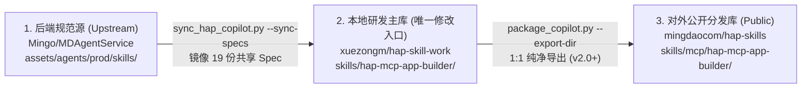

# HAP Skill Work（明道云 AI 技能套件）

本仓库整合了面向明道云（HAP）低代码平台的全生命周期 AI Agent 技能（Skills），涵盖应用设计与搭建、存量应用演进与逆向重构、高难度测试用例生成以及技能规范治理。

---

## 📦 技能套件清单

| 技能名称 | 目录 | 定位与核心能力 |
| :--- | :--- | :--- |
| **hap-mcp-app-builder** | [`hap-mcp-app-builder/`](./hap-mcp-app-builder) | **HAP 应用与数据全生命周期助手**：从 0 到 1 架构规划与搭建、存量应用渐进式修改/重构，以及日常业务数据查询统计、记录增删改、审批待办处理与流程触发。 |
| **hap-testcase-generator** | [`hap-testcase-generator/`](./hap-testcase-generator) | **场景化测试用例批量生成器**：基于真实业务口吻（存量刷数、离职交接、软删除、极简指令）批量生成高仿真、具有挑战性的修改与搭建用例集。 |
| **skill-maintainer** | [`skill-maintainer/`](./skill-maintainer) | **Skill 维护与内容治理规范**：审查和规范 Agent/Codex Skill 的文件分工、单一事实源、引用关系、加载层级及内容粒度。 |

---

## 🚀 快速上手与集成

### 1. 本地安装到 Agent / Codex / Claude Code
将对应的技能目录软链接或复制到全局技能配置目录（如 `~/.gemini/config/skills/` 或各 Agent 的技能根目录）：

```bash
# 示例：安装 hap-mcp-app-builder 到全局技能库
ln -s "$(pwd)/hap-mcp-app-builder" ~/.gemini/config/skills/hap-mcp-app-builder
```

### 2. 依赖环境与 MCP
- **MCP 服务**：`hap_meihua_mcp` / `hap_personal_mcp` / `hap_sandbox_mcp`
- **运行环境**：Python 3.10+（部分预计算与校验辅助脚本使用标准库）

---

## 🔄 三端仓库关系与日常维护 / 发布流程（AI 与维护者必读）



### 1. 角色分工（日常永远只改本地研发主库）

| 仓库 / 目录 | 定位 | 维护规则 |
| :--- | :--- | :--- |
| **① 后端规范源**<br>`/Users/user/AI-work/Mingo/MDAgentService/assets/agents/prod` | 线上 C# 服务端与本地共用的 **19 份底层领域 Spec 唯一真值源** | 修改通用领域参数规则（`hap-domain-*-spec` / `*-guide`）时先改此处，再通过同步脚本镜像到本地研发库 |
| **② 本地研发主库（当前仓库）**<br>`/Users/user/AI-work/应用搭建skill/skills/hap-mcp-app-builder` | **日常开发、调试与测试的唯一主入口**（Git 远端：`xuezongm/hap-skill-work`） | **所有工作流（Plan / Build / Modify / Data）、SOP 与脚本修改均在此目录完成**，配套 `skill-maintainer` 执行严格静态审计与 90+ 项单测 |
| **③ 对外公开分发库**<br>`https://github.com/mingdaocom/hap-skills`<br>路径：`skills/mcp/hap-mcp-app-builder` | 面向外部用户的公开安装源（支持 `npx skills add mingdaocom/hap-skills --skill hap-mcp-app-builder` 及基于 `version.json` 的自动升级） | **禁止直接手改公开库**；每次在本地研发主库改完并通过测试后，用下方一键导出命令覆盖同步并推送 |

### 2. 标准维护与公开发布三步曲

当用户或维护者需要**“同步上游规格”**或**“发布更新到公开仓库 `mingdaocom/hap-skills`”**时，AI 直接按以下顺序执行：

```bash
# 第一步：同步后端 19 份共享 Spec 并运行严格审计与全量单测
python3 /Users/user/AI-work/应用搭建skill/skills/skill-maintainer/scripts/sync_hap_copilot.py --sync-specs --check
python3 /Users/user/AI-work/应用搭建skill/skills/skill-maintainer/scripts/audit_skill.py --strict /Users/user/AI-work/应用搭建skill/skills/hap-mcp-app-builder
python3 -B -m unittest discover -s /Users/user/AI-work/应用搭建skill/skills/skill-maintainer/tests -v

# 第二步：一键将 hap-mcp-app-builder 纯净发布文件导出至公开库目录
# 注：若需提示已安装用户升级，导出前先将 hap-mcp-app-builder/version.json 中的 version 递增（如 2.0.0 -> 2.0.1）
python3 /Users/user/AI-work/应用搭建skill/skills/skill-maintainer/scripts/package_copilot.py \
  --export-dir /Users/user/AI-work/应用搭建skill/.hap-copilot/hap-skills/skills/mcp/hap-mcp-app-builder

# 第三步：在公开库克隆目录中提交并推送（需获用户明确授权 git push）
git -C /Users/user/AI-work/应用搭建skill/.hap-copilot/hap-skills add skills/mcp/hap-mcp-app-builder README.md
git -C /Users/user/AI-work/应用搭建skill/.hap-copilot/hap-skills commit -m "feat(hap-mcp-app-builder): 同步更新应用助手"
git -C /Users/user/AI-work/应用搭建skill/.hap-copilot/hap-skills push origin main
```

---

## 维护文档

- [Copilot 与 AgentService 的共享内容及同步规则](./skill-maintainer/references/hap-copilot-sync.md)：共享镜像清单、本地适配文件、权威位置、版本对照、同步命令及未覆盖范围。供仓库维护者使用，不属于 `hap-mcp-app-builder` 的业务使用入口。
- [Copilot 发布包维护](./skill-maintainer/references/copilot-release.md)：依赖与许可证说明、发布清单检查、杂项排除及 ZIP 打包方式。

## 📄 License
MIT License
