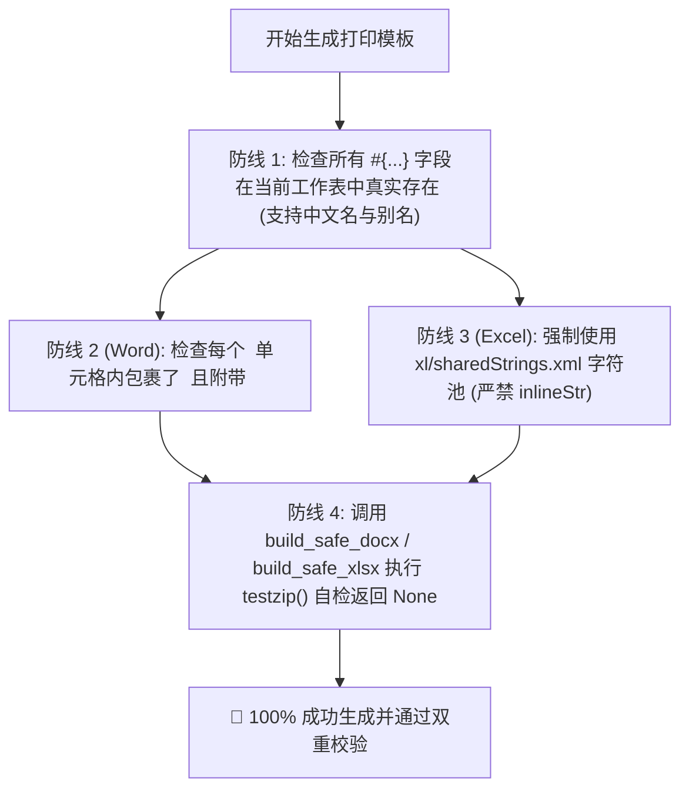

# HAP 打印模板平台规格 (spec-print-templates)

本文档是明道云（HAP）打印模板的设计与接口规范唯一权威事实源（SSOT）。涵盖选型阶梯、占位符全能速查表、零依赖 Python 生成引擎、高保真 XML 骨架及平台防坑铁律。

---

## 目录

1. [打印模板选型决策矩阵](#一-打印模板选型决策矩阵)
2. [占位符全能速查大表 (All-in-One Cheat Sheet)](#二-占位符全能速查大表-all-in-one-cheat-sheet)
3. [文件模板生成引擎与自由排版积木库](#三-文件模板生成引擎与自由排版积木库)
4. [OpenXML 结构 5 大防坑铁律与排障 (Hard Limits)](#四-openxml-结构-5-大防坑铁律与排障-hard-limits)
5. [权限配置与生命周期管理](#五-权限配置与生命周期管理)

---

## 一、 打印模板选型决策矩阵

| 评估维度 | ① 系统内置模板 (`system` / `barCode` / `qrCode`) | ② 自定义 Word 模板 (`word`, `.docx`) | ③ 自定义 Excel 模板 (`excel`, `.xlsx`) |
| :--- | :--- | :--- | :--- |
| **选型阶梯** | **第一层（优先默认）** | **第二层（升级定制）** | **第二层（升级定制）** |
| **文件要求** | **免文件**，零成本调用 API 秒级开箱生成 | 上传标准 `.docx` 模板文件 | 上传标准 `.xlsx` 模板文件 |
| **排版特性** | 标准表单排版，白底黑码 | **流式卡片排版、图文与动态条码混排** | **网格栅格对齐、多列严密矩阵** |
| **明细展开** | 原生子表格展示 | 支持**表格逐行扩展**或**块状逐条循环** | 仅支持表格逐行向下扩展 |
| **典型场景** | 日常内部打印单、简易条码、二维码标签 | 有样式排版要求时，正式文件、劳动合同、审批归档卡、**精美固定资产卡片、流转卡** | 记账凭证、物料清单(BOM)、**多格不干胶批量条码套打** |
| **对应 MCP 工具** | `create_system_print_template`<br>`create_barcode_print_template`<br>`create_qr_code_print_template` | `create_file_print_template`<br>(`templateType: "word"`) | `create_file_print_template`<br>(`templateType: "excel"`) |

> **工具名判定**：`create_file_print_template` 是文件打印模板的有效工具名，不得因另一会话或另一 MCP 服务未暴露它，就标记为“旧工具”或擅自替换。执行时以本次选定的目标 MCP 服务所返回的实时工具定义为准；只有该服务明确不提供某工具时，才重新选择等价能力或转人工。

---

## 二、 占位符全能速查大表 (All-in-One Cheat Sheet)

所有占位符以 `#{` 开头、以 `}` 结尾。**必须优先使用字段别名（alias）或字段 ID**（确保当前工作表中真实存在）。

### 2.1 占位符语法汇总

| 分类 | 语法示例 | 说明与渲染效果 |
| :--- | :--- | :--- |
| **普通表单字段** | `#{biz_title}` 或 `#{书名}` | 输出字段填写的原始文本、数值或选项名称 |
| **系统字段** | `#{caid}` / `#{ownerid}`<br>`#{ctime}` / `#{utime}` / `#{ptime}`<br>`#{rowid}` | 创建人 / 拥有者姓名<br>创建时间 / 修改时间 / 打印时间<br>记录 ID |
| **日期格式** | `#{biz_date$[yyyy-MM-dd]$}` | 按指定日期格式输出 |
| **条码 / 二维码** | `#{[barcode]biz_code$[40*10]$}`<br>`#{[qrcode]sharelink$[20*20_H]$}` | 生成条码或二维码，而非输出占位符文本 |
| **图片填充** | `#{cover$[auto*25_F]$}` | 图片按指定尺寸填充，避免撑高合并单元格 |

---

## 三、 文件模板生成引擎与自由排版积木库

> [!TIP]
> **排版设计拥有完全的艺术自由！**
> AI **绝不仅限于表格单据**，应根据具体业务场景（如：**严肃法律合同、双面资产吊牌、荣誉证书/奖状、审批会签单、或用户提供的参考图**）自由选择配色（科技蓝、商务黑金、极简黑白、医疗绿）、字体尺寸、多栏布局与段落格式。只需自由拼接以下合规的 **OpenXML 排版积木**。

### 3.1 Word (.docx) 模板生成引擎（Python 零依赖 · 内置 CRC-32 强校验）

无论生成何种版式，**统一调用此标准函数将 XML 字符串安全打包为 Base64**：

```python
import zipfile, base64, io

def build_safe_docx(document_xml_str: str) -> str:
    """构建 100% 合规、零损坏、带 CRC 校验的 Word 模板并返回纯 Base64"""
    content_types = '<?xml version="1.0" encoding="UTF-8" standalone="yes"?><Types xmlns="http://schemas.openxmlformats.org/package/2006/content-types"><Default Extension="rels" ContentType="application/vnd.openxmlformats-package.relationships+xml"/><Default Extension="xml" ContentType="application/xml"/><Override PartName="/word/document.xml" ContentType="application/vnd.openxmlformats-officedocument.wordprocessingml.document.main+xml"/><Override PartName="/word/styles.xml" ContentType="application/vnd.openxmlformats-officedocument.wordprocessingml.styles+xml"/><Override PartName="/docProps/core.xml" ContentType="application/vnd.openxmlformats-package.core-properties+xml"/><Override PartName="/docProps/app.xml" ContentType="application/vnd.openxmlformats-officedocument.extended-properties+xml"/></Types>'
    rels = '<?xml version="1.0" encoding="UTF-8" standalone="yes"?><Relationships xmlns="http://schemas.openxmlformats.org/package/2006/relationships"><Relationship Id="rId1" Type="http://schemas.openxmlformats.org/officeDocument/2006/relationships/officeDocument" Target="word/document.xml"/><Relationship Id="rId2" Type="http://schemas.openxmlformats.org/package/2006/relationships/metadata/core-properties" Target="docProps/core.xml"/><Relationship Id="rId3" Type="http://schemas.openxmlformats.org/officeDocument/2006/relationships/extended-properties" Target="docProps/app.xml"/></Relationships>'
    doc_rels = '<?xml version="1.0" encoding="UTF-8" standalone="yes"?><Relationships xmlns="http://schemas.openxmlformats.org/package/2006/relationships"><Relationship Id="rId1" Type="http://schemas.openxmlformats.org/officeDocument/2006/relationships/styles" Target="styles.xml"/></Relationships>'
    styles_xml = '<?xml version="1.0" encoding="UTF-8" standalone="yes"?><w:styles xmlns:w="http://schemas.openxmlformats.org/wordprocessingml/2006/main"><w:docDefaults><w:rPrDefault><w:rPr><w:rFonts w:ascii="Microsoft YaHei" w:eastAsia="Microsoft YaHei" w:hAnsi="Microsoft YaHei"/><w:sz w:val="21"/><w:lang w:val="zh-CN"/></w:rPr></w:rPrDefault></w:docDefaults></w:styles>'
    core_xml = '<?xml version="1.0" encoding="UTF-8" standalone="yes"?><cp:coreProperties xmlns:cp="http://schemas.openxmlformats.org/package/2006/metadata/core-properties" xmlns:dc="http://purl.org/dc/elements/1.1/"><dc:title>PrintTemplate</dc:title><dc:creator>HAP</dc:creator></cp:coreProperties>'
    app_xml = '<?xml version="1.0" encoding="UTF-8" standalone="yes"?><Properties xmlns="http://schemas.openxmlformats.org/officeDocument/2006/extended-properties"><Application>HAP App Builder</Application></Properties>'

    buf = io.BytesIO()
    with zipfile.ZipFile(buf, "w", compression=zipfile.ZIP_DEFLATED) as z:
        z.writestr("[Content_Types].xml", content_types.encode("utf-8"))
        z.writestr("_rels/.rels", rels.encode("utf-8"))
        z.writestr("word/_rels/document.xml.rels", doc_rels.encode("utf-8"))
        z.writestr("word/document.xml", document_xml_str.encode("utf-8"))
        z.writestr("word/styles.xml", styles_xml.encode("utf-8"))
        z.writestr("docProps/core.xml", core_xml.encode("utf-8"))
        z.writestr("docProps/app.xml", app_xml.encode("utf-8"))

    buf.seek(0)
    with zipfile.ZipFile(buf, "r") as z_check:
        corrupt = z_check.testzip()
        if corrupt:
            raise ValueError(f"DOCX ZIP corrupted at member: {corrupt}")

    return base64.b64encode(buf.getvalue()).decode("ascii")
```

---

### 3.2 Excel (.xlsx) 模板生成引擎（强制依赖 sharedStrings.xml 字符池）

> [!IMPORTANT]
> **Excel 模板核心底层规范**：明道云后台 POI 解析引擎对 Excel 模板有强 Schema 约束。**所有单元格字符串（包含静态表头与 `#{...}` 占位符）必须通过 `xl/sharedStrings.xml` 共享字符串字典池存储与 `<v>{idx}</v>` 索引引用**，严禁使用 `<c t="inlineStr">` 内联文本，否则服务端在解析单元格模型时将抛出 `NullPointerException` 导致导出提示“系统错误 / 导出失败”！

```python
import base64, io, re, zipfile
from xml.etree import ElementTree as ET
from xml.sax import saxutils

_COL_RE = re.compile(r"^[A-Z]{1,3}$")
_REQUIRED_XLSX_PARTS = {
    "[Content_Types].xml", "_rels/.rels", "xl/workbook.xml",
    "xl/_rels/workbook.xml.rels", "xl/styles.xml", "xl/sharedStrings.xml",
    "xl/worksheets/sheet1.xml", "docProps/core.xml", "docProps/app.xml",
}

def build_safe_xlsx(cells_grid: list[list[dict]], merges: list[str], sheet_name: str = "Sheet1") -> tuple[str, bytes]:
    """构建标准 XLSX；所有文本（含 #{...}）均使用 sharedStrings，禁止 inlineStr。"""
    if not sheet_name:
        raise ValueError("sheet_name 不能为空")
    shared_strings, str_to_idx, string_count = [], {}, 0

    def get_str_idx(s: str) -> int:
        nonlocal string_count
        string_count += 1
        if s not in str_to_idx:
            str_to_idx[s] = len(shared_strings)
            shared_strings.append(s)
        return str_to_idx[s]

    sheet_rows = []
    for row_idx, row in enumerate(cells_grid, start=1):
        c_xmls = []
        ht = 24
        for cell in row:
            col_letter = str(cell["col"]).upper()
            if not _COL_RE.fullmatch(col_letter):
                raise ValueError(f"非法列名: {col_letter}")
            r_coord = f"{col_letter}{row_idx}"
            s_idx = int(cell.get("style", 0))
            if not 0 <= s_idx <= 3:
                raise ValueError(f"{r_coord} 的 style 必须为 0~3")
            val = cell.get("val")
            if "ht" in cell:
                ht = cell["ht"]
            if val is not None and str(val) != "" and cell.get("type") == "number":
                c_xmls.append(f'<c r="{r_coord}" s="{s_idx}"><v>{val}</v></c>')
            elif val is not None and str(val) != "":
                val_str = str(val)
                str_idx = get_str_idx(val_str)
                c_xmls.append(f'<c r="{r_coord}" t="s" s="{s_idx}"><v>{str_idx}</v></c>')
            else:
                c_xmls.append(f'<c r="{r_coord}" s="{s_idx}"/>')
        row_xml = f'<row r="{row_idx}" ht="{ht}" customHeight="1">{"".join(c_xmls)}</row>'
        sheet_rows.append(row_xml)

    merge_xmls = "".join([f'<mergeCell ref="{m}"/>' for m in merges])
    merge_block = f'<mergeCells count="{len(merges)}">{merge_xmls}</mergeCells>' if merges else ""

    sheet1_xml = f'''<?xml version="1.0" encoding="UTF-8" standalone="yes"?>
<worksheet xmlns="http://schemas.openxmlformats.org/spreadsheetml/2006/main" xmlns:r="http://schemas.openxmlformats.org/officeDocument/2006/relationships">
    <sheetViews><sheetView tabSelected="1" workbookViewId="0"/></sheetViews>
    <sheetFormatPr defaultRowHeight="22" customHeight="1"/>
    <cols>
        <col min="1" max="1" width="8" customWidth="1"/>
        <col min="2" max="2" width="16" customWidth="1"/>
        <col min="3" max="3" width="22" customWidth="1"/>
        <col min="4" max="4" width="16" customWidth="1"/>
        <col min="5" max="5" width="16" customWidth="1"/>
        <col min="6" max="6" width="14" customWidth="1"/>
        <col min="7" max="7" width="14" customWidth="1"/>
        <col min="8" max="8" width="30" customWidth="1"/>
    </cols>
    <sheetData>
        {"".join(sheet_rows)}
    </sheetData>
    {merge_block}
    <pageMargins left="0.6" right="0.6" top="0.75" bottom="0.75" header="0.3" footer="0.3"/>
</worksheet>'''

    si_xmls = [f'<si><t xml:space="preserve">{saxutils.escape(s)}</t></si>' for s in shared_strings]
    shared_strings_xml = f'''<?xml version="1.0" encoding="UTF-8" standalone="yes"?>
<sst xmlns="http://schemas.openxmlformats.org/spreadsheetml/2006/main" count="{string_count}" uniqueCount="{len(shared_strings)}">
    {"".join(si_xmls)}
</sst>'''

    content_types = '''<?xml version="1.0" encoding="UTF-8" standalone="yes"?>
<Types xmlns="http://schemas.openxmlformats.org/package/2006/content-types">
    <Default Extension="rels" ContentType="application/vnd.openxmlformats-package.relationships+xml"/>
    <Default Extension="xml" ContentType="application/xml"/>
    <Override PartName="/xl/workbook.xml" ContentType="application/vnd.openxmlformats-officedocument.spreadsheetml.sheet.main+xml"/>
    <Override PartName="/xl/worksheets/sheet1.xml" ContentType="application/vnd.openxmlformats-officedocument.spreadsheetml.worksheet+xml"/>
    <Override PartName="/xl/styles.xml" ContentType="application/vnd.openxmlformats-officedocument.spreadsheetml.styles+xml"/>
    <Override PartName="/xl/sharedStrings.xml" ContentType="application/vnd.openxmlformats-officedocument.spreadsheetml.sharedStrings+xml"/>
    <Override PartName="/docProps/core.xml" ContentType="application/vnd.openxmlformats-package.core-properties+xml"/>
    <Override PartName="/docProps/app.xml" ContentType="application/vnd.openxmlformats-officedocument.extended-properties+xml"/>
</Types>'''

    rels = '''<?xml version="1.0" encoding="UTF-8" standalone="yes"?>
<Relationships xmlns="http://schemas.openxmlformats.org/package/2006/relationships">
    <Relationship Id="rId1" Type="http://schemas.openxmlformats.org/officeDocument/2006/relationships/officeDocument" Target="xl/workbook.xml"/>
    <Relationship Id="rId2" Type="http://schemas.openxmlformats.org/package/2006/relationships/metadata/core-properties" Target="docProps/core.xml"/>
    <Relationship Id="rId3" Type="http://schemas.openxmlformats.org/officeDocument/2006/relationships/extended-properties" Target="docProps/app.xml"/>
</Relationships>'''

    wb_rels = '''<?xml version="1.0" encoding="UTF-8" standalone="yes"?>
<Relationships xmlns="http://schemas.openxmlformats.org/package/2006/relationships">
    <Relationship Id="rId1" Type="http://schemas.openxmlformats.org/officeDocument/2006/relationships/worksheet" Target="worksheets/sheet1.xml"/>
    <Relationship Id="rId2" Type="http://schemas.openxmlformats.org/officeDocument/2006/relationships/styles" Target="styles.xml"/>
    <Relationship Id="rId3" Type="http://schemas.openxmlformats.org/officeDocument/2006/relationships/sharedStrings" Target="sharedStrings.xml"/>
</Relationships>'''

    styles_xml = '''<?xml version="1.0" encoding="UTF-8" standalone="yes"?>
<styleSheet xmlns="http://schemas.openxmlformats.org/spreadsheetml/2006/main">
  <fonts count="1"><font><sz val="11"/><name val="Microsoft YaHei"/></font></fonts>
  <fills count="2"><fill><patternFill patternType="none"/></fill><fill><patternFill patternType="gray125"/></fill></fills>
  <borders count="1"><border/></borders>
  <cellStyleXfs count="1"><xf numFmtId="0" fontId="0" fillId="0" borderId="0"/></cellStyleXfs>
  <cellXfs count="4"><xf numFmtId="0" fontId="0" fillId="0" borderId="0" xfId="0"/><xf numFmtId="0" fontId="0" fillId="0" borderId="0" xfId="0" applyAlignment="1"><alignment horizontal="center" vertical="center"/></xf><xf numFmtId="0" fontId="0" fillId="0" borderId="0" xfId="0" applyAlignment="1"><alignment vertical="center" wrapText="1"/></xf><xf numFmtId="0" fontId="0" fillId="0" borderId="0" xfId="0" applyAlignment="1"><alignment horizontal="center" vertical="center" wrapText="1"/></xf></cellXfs>
  <cellStyles count="1"><cellStyle name="Normal" xfId="0" builtinId="0"/></cellStyles>
</styleSheet>'''

    sheet_name_attr = saxutils.quoteattr(sheet_name)[1:-1]
    workbook_xml = f'''<?xml version="1.0" encoding="UTF-8" standalone="yes"?>
<workbook xmlns="http://schemas.openxmlformats.org/spreadsheetml/2006/main" xmlns:r="http://schemas.openxmlformats.org/officeDocument/2006/relationships">
    <sheets><sheet name="{sheet_name_attr}" sheetId="1" r:id="rId1"/></sheets>
</workbook>'''

    core_xml = f'''<?xml version="1.0" encoding="UTF-8" standalone="yes"?>
<cp:coreProperties xmlns:cp="http://schemas.openxmlformats.org/package/2006/metadata/core-properties" xmlns:dc="http://purl.org/dc/elements/1.1/"><dc:title>{saxutils.escape(sheet_name)}</dc:title><dc:creator>HAP</dc:creator></cp:coreProperties>'''
    app_xml = '''<?xml version="1.0" encoding="UTF-8" standalone="yes"?>
<Properties xmlns="http://schemas.openxmlformats.org/officeDocument/2006/extended-properties"><Application>HAP</Application></Properties>'''

    buf = io.BytesIO()
    with zipfile.ZipFile(buf, "w", compression=zipfile.ZIP_DEFLATED) as z:
        z.writestr("[Content_Types].xml", content_types.encode("utf-8"))
        z.writestr("_rels/.rels", rels.encode("utf-8"))
        z.writestr("xl/_rels/workbook.xml.rels", wb_rels.encode("utf-8"))
        z.writestr("xl/workbook.xml", workbook_xml.encode("utf-8"))
        z.writestr("xl/styles.xml", styles_xml.encode("utf-8"))
        z.writestr("xl/sharedStrings.xml", shared_strings_xml.encode("utf-8"))
        z.writestr("xl/worksheets/sheet1.xml", sheet1_xml.encode("utf-8"))
        z.writestr("docProps/core.xml", core_xml.encode("utf-8"))
        z.writestr("docProps/app.xml", app_xml.encode("utf-8"))

    buf.seek(0)
    with zipfile.ZipFile(buf, "r") as z_check:
        corrupt = z_check.testzip()
        if corrupt:
            raise ValueError(f"XLSX ZIP corrupted at member: {corrupt}")
        missing = _REQUIRED_XLSX_PARTS - set(z_check.namelist())
        if missing:
            raise ValueError(f"XLSX 缺少标准部件: {sorted(missing)}")
        for part in _REQUIRED_XLSX_PARTS:
            ET.fromstring(z_check.read(part))
        if b'/xl/sharedStrings.xml' not in z_check.read("[Content_Types].xml") or b'/sharedStrings"' not in z_check.read("xl/_rels/workbook.xml.rels"):
            raise ValueError("XLSX sharedStrings.xml 的 ContentTypes/关系链不完整")
        if b't="inlineStr"' in z_check.read("xl/worksheets/sheet1.xml"):
            raise ValueError("XLSX 禁止使用 inlineStr")

    return base64.b64encode(buf.getvalue()).decode("ascii"), buf.getvalue()
```

---

### 3.3 自由创作积木库 (Design Building Blocks)

在 `<w:document ...><w:body>` 与 `</w:body></w:document>` 之间，按需自由组合以下积木：

#### 积木 A：头部 Header 积木（3 种常用风格）
- **风格 1：左侧标题 + 右侧动态条码/二维码**（适用于归档卡、设备标牌、流转单）：
```xml
<w:tbl>
    <w:tblPr><w:tblW w:w="9600" w:type="dxa"/><w:tblBorders><w:top w:val="none"/><w:left w:val="none"/><w:bottom w:val="single" w:sz="18" w:space="0" w:color="1B365D"/><w:right w:val="none"/><w:insideH w:val="none"/><w:insideV w:val="none"/></w:tblBorders><w:tblCellMar><w:top w:w="80" w:type="dxa"/><w:bottom w:w="120" w:type="dxa"/><w:left w:w="100" w:type="dxa"/><w:right w:w="100" w:type="dxa"/></w:tblCellMar></w:tblPr>
    <w:tblGrid><w:gridCol w:w="6000"/><w:gridCol w:w="3600"/></w:tblGrid>
    <w:tr>
        <w:tc><w:tcPr><w:tcW w:w="6000" w:type="dxa"/><w:vAlign w:val="center"/></w:tcPr>
            <w:p><w:pPr><w:spacing w:before="0" w:after="40"/></w:pPr><w:r><w:rPr><w:b/><w:sz w:val="38"/><w:color w:val="1B365D"/></w:rPr><w:t>单据大标题</w:t></w:r></w:p>
            <w:p><w:pPr><w:spacing w:before="0" w:after="0"/></w:pPr><w:r><w:rPr><w:sz w:val="18"/><w:color w:val="7F8C8D"/></w:rPr><w:t>SUBTITLE &amp; CODE</w:t></w:r></w:p>
        </w:tc>
        <w:tc><w:tcPr><w:tcW w:w="3600" w:type="dxa"/><w:vAlign w:val="center"/></w:tcPr>
            <w:p><w:pPr><w:jc w:val="right"/><w:spacing w:before="0" w:after="0"/></w:pPr><w:r><w:rPr><w:sz w:val="18"/></w:rPr><w:t>#{[barcode]biz_code$[40*10]$}</w:t></w:r></w:p>
        </w:tc>
    </w:tr>
</w:tbl>
```
- **风格 2：正式公文/合同居中大标题**（适用于采购合同、人事协议、通知）：
```xml
<w:p><w:pPr><w:jc w:val="center"/><w:spacing w:before="120" w:after="160"/></w:pPr>
    <w:r><w:rPr><w:b/><w:sz w:val="44"/><w:color w:val="000000"/></w:rPr><w:t>劳动合同协议书</w:t></w:r>
</w:p>
<w:p><w:pPr><w:jc w:val="right"/><w:spacing w:before="0" w:after="80"/></w:pPr>
    <w:r><w:rPr><w:sz w:val="19"/><w:color w:val="555555"/></w:rPr><w:t>合同编号：#{contract_no}</w:t></w:r>
</w:p>
```

#### 积木 B：数据网格积木（2 列 / 4 列对齐）
```xml
<w:tbl>
    <w:tblPr><w:tblW w:w="9600" w:type="dxa"/><w:tblBorders><w:top w:val="single" w:sz="6" w:color="D1DCE5"/><w:left w:val="single" w:sz="6" w:color="D1DCE5"/><w:bottom w:val="single" w:sz="6" w:color="D1DCE5"/><w:right w:val="single" w:sz="6" w:color="D1DCE5"/><w:insideH w:val="single" w:sz="4" w:color="E5ECF2"/><w:insideV w:val="single" w:sz="4" w:color="E5ECF2"/></w:tblBorders><w:tblCellMar><w:top w:w="80" w:type="dxa"/><w:bottom w:w="80" w:type="dxa"/><w:left w:w="120" w:type="dxa"/><w:right w:w="120" w:type="dxa"/></w:tblCellMar></w:tblPr>
    <w:tblGrid><w:gridCol w:w="1800"/><w:gridCol w:w="3000"/><w:gridCol w:w="1800"/><w:gridCol w:w="3000"/></w:tblGrid>
    <w:tr>
        <w:tc><w:tcPr><w:tcW w:w="1800" w:type="dxa"/><w:shd w:val="clear" w:color="auto" w:fill="F8F9F9"/><w:vAlign w:val="center"/></w:tcPr><w:p><w:r><w:rPr><w:b/><w:sz w:val="20"/><w:color w:val="34495E"/></w:rPr><w:t>业务名称</w:t></w:r></w:p></w:tc>
        <w:tc><w:tcPr><w:tcW w:w="3000" w:type="dxa"/><w:vAlign w:val="center"/></w:tcPr><w:p><w:r><w:rPr><w:sz w:val="20"/></w:rPr><w:t>#{biz_title}</w:t></w:r></w:p></w:tc>
        <w:tc><w:tcPr><w:tcW w:w="1800" w:type="dxa"/><w:shd w:val="clear" w:color="auto" w:fill="F8F9F9"/><w:vAlign w:val="center"/></w:tcPr><w:p><w:r><w:rPr><w:b/><w:sz w:val="20"/><w:color w:val="34495E"/></w:rPr><w:t>当前状态</w:t></w:r></w:p></w:tc>
        <w:tc><w:tcPr><w:tcW w:w="3000" w:type="dxa"/><w:vAlign w:val="center"/></w:tcPr><w:p><w:r><w:rPr><w:b/><w:sz w:val="20"/><w:color w:val="2980B9"/></w:rPr><w:t>#{biz_status}</w:t></w:r></w:p></w:tc>
    </w:tr>
</w:tbl>
```

#### 积木 C：法律条款与段落正文积木（首行缩进与行间距）
```xml
<!-- 小节标题 -->
<w:p><w:pPr><w:spacing w:before="140" w:after="60"/></w:pPr>
    <w:r><w:rPr><w:b/><w:sz w:val="24"/><w:color w:val="1B365D"/></w:rPr><w:t>第一条 合同目的与工作内容</w:t></w:r>
</w:p>
<!-- 条款正文：缩进 2 字符 (420 dxa) 与 1.25 倍舒适行距 -->
<w:p><w:pPr><w:ind w:firstLine="420"/><w:spacing w:line="340" w:lineRule="auto" w:before="0" w:after="40"/></w:pPr>
    <w:r><w:rPr><w:sz w:val="21"/></w:rPr><w:t xml:space="preserve">甲方根据业务发展需要，聘用乙方在 #{biz_dept} 部门担任 #{biz_position} 岗位工作。乙方应按照甲方要求保质保量完成工作职责，并遵守各项规章制度。</w:t></w:r>
</w:p>
```

#### 积木 D：子表明细表格与签字盖章双栏
- **子表明细表格（逐行循环展开）**：
```xml
<w:tbl>
    <w:tblPr><w:tblW w:w="9600" w:type="dxa"/><w:tblBorders><w:top w:val="single" w:sz="6" w:color="BDC3C7"/><w:left w:val="single" w:sz="6" w:color="BDC3C7"/><w:bottom w:val="single" w:sz="6" w:color="BDC3C7"/><w:right w:val="single" w:sz="6" w:color="BDC3C7"/><w:insideH w:val="single" w:sz="4" w:color="ECF0F1"/><w:insideV w:val="single" w:sz="4" w:color="ECF0F1"/></w:tblBorders><w:tblCellMar><w:top w:w="80" w:type="dxa"/><w:bottom w:w="80" w:type="dxa"/><w:left w:w="120" w:type="dxa"/><w:right w:w="120" w:type="dxa"/></w:tblCellMar></w:tblPr>
    <w:tblGrid><w:gridCol w:w="1000"/><w:gridCol w:w="3000"/><w:gridCol w:w="2600"/><w:gridCol w:w="3000"/></w:tblGrid>
    <!-- 表头 -->
    <w:tr><w:tc><w:tcPr><w:tcW w:w="1000" w:type="dxa"/><w:shd w:val="clear" w:color="auto" w:fill="F8F9F9"/><w:vAlign w:val="center"/></w:tcPr><w:p><w:pPr><w:jc w:val="center"/></w:pPr><w:r><w:rPr><w:b/><w:sz w:val="19"/></w:rPr><w:t>序号</w:t></w:r></w:p></w:tc><w:tc><w:tcPr><w:tcW w:w="3000" w:type="dxa"/><w:shd w:val="clear" w:color="auto" w:fill="F8F9F9"/><w:vAlign w:val="center"/></w:tcPr><w:p><w:r><w:rPr><w:b/><w:sz w:val="19"/></w:rPr><w:t>项目名称</w:t></w:r></w:p></w:tc><w:tc><w:tcPr><w:tcW w:w="2600" w:type="dxa"/><w:shd w:val="clear" w:color="auto" w:fill="F8F9F9"/><w:vAlign w:val="center"/></w:tcPr><w:p><w:r><w:rPr><w:b/><w:sz w:val="19"/></w:rPr><w:t>发生日期</w:t></w:r></w:p></w:tc><w:tc><w:tcPr><w:tcW w:w="3000" w:type="dxa"/><w:shd w:val="clear" w:color="auto" w:fill="F8F9F9"/><w:vAlign w:val="center"/></w:tcPr><w:p><w:r><w:rPr><w:b/><w:sz w:val="19"/></w:rPr><w:t>备注说明</w:t></w:r></w:p></w:tc></w:tr>
    <!-- 数据行（自动循环） -->
    <w:tr><w:tc><w:tcPr><w:tcW w:w="1000" w:type="dxa"/><w:vAlign w:val="center"/></w:tcPr><w:p><w:pPr><w:jc w:val="center"/></w:pPr><w:r><w:rPr><w:sz w:val="18"/><w:color w:val="7F8C8D"/></w:rPr><w:t>#{明细子表.sequencenumber}</w:t></w:r></w:p></w:tc><w:tc><w:tcPr><w:tcW w:w="3000" w:type="dxa"/><w:vAlign w:val="center"/></w:tcPr><w:p><w:r><w:rPr><w:sz w:val="18"/></w:rPr><w:t>#{明细子表.biz_item_name}</w:t></w:r></w:p></w:tc><w:tc><w:tcPr><w:tcW w:w="2600" w:type="dxa"/><w:vAlign w:val="center"/></w:tcPr><w:p><w:r><w:rPr><w:sz w:val="18"/></w:rPr><w:t>#{明细子表.biz_date$[yyyy-MM-dd]$}</w:t></w:r></w:p></w:tc><w:tc><w:tcPr><w:tcW w:w="3000" w:type="dxa"/><w:vAlign w:val="center"/></w:tcPr><w:p><w:r><w:rPr><w:sz w:val="18"/></w:rPr><w:t>#{明细子表.biz_remark}</w:t></w:r></w:p></w:tc></w:tr>
</w:tbl>
```
- **签字盖章双栏（无边框对齐）**：
```xml
<w:tbl>
    <w:tblPr><w:tblW w:w="9600" w:type="dxa"/><w:tblBorders><w:top w:val="none"/><w:left w:val="none"/><w:bottom w:val="none"/><w:right w:val="none"/><w:insideH w:val="none"/><w:insideV w:val="none"/></w:tblBorders></w:tblPr>
    <w:tblGrid><w:gridCol w:w="4800"/><w:gridCol w:w="4800"/></w:tblGrid>
    <w:tr>
        <w:tc><w:tcPr><w:tcW w:w="4800" w:type="dxa"/></w:tcPr>
            <w:p><w:r><w:rPr><w:b/><w:sz w:val="21"/></w:rPr><w:t>甲方（盖章）：__________________</w:t></w:r></w:p>
            <w:p><w:r><w:rPr><w:sz w:val="20"/></w:rPr><w:t>法定代表人：____________________</w:t></w:r></w:p>
            <w:p><w:r><w:rPr><w:sz w:val="20"/></w:rPr><w:t>签署日期：_____年____月____日</w:t></w:r></w:p>
        </w:tc>
        <w:tc><w:tcPr><w:tcW w:w="4800" w:type="dxa"/></w:tcPr>
            <w:p><w:r><w:rPr><w:b/><w:sz w:val="21"/></w:rPr><w:t>乙方（签字）：__________________</w:t></w:r></w:p>
            <w:p><w:r><w:rPr><w:sz w:val="20"/></w:rPr><w:t>身份证号：#{id_card_no}</w:t></w:r></w:p>
            <w:p><w:r><w:rPr><w:sz w:val="20"/></w:rPr><w:t>签署日期：_____年____月____日</w:t></w:r></w:p>
        </w:tc>
    </w:tr>
</w:tbl>
```

#### 积木 E：纸张规格与分节控制（必填末尾积木）
- **A4 竖版（默认）**：
```xml
<w:sectPr>
    <w:pgSz w:w="11906" w:h="16838"/>
    <w:pgMar w:top="1134" w:right="1134" w:bottom="1134" w:left="1134" w:header="708" w:footer="708" w:gutter="0"/>
</w:sectPr>
```
- **A4 横版（适用于多列大台账/荣誉证书）**：
```xml
<w:sectPr>
    <w:pgSz w:w="16838" w:h="11906" w:orient="landscape"/>
    <w:pgMar w:top="1134" w:right="1134" w:bottom="1134" w:left="1134" w:header="708" w:footer="708" w:gutter="0"/>
</w:sectPr>
```
- **设备小吊牌 / 不干胶标签纸（如 80mm * 50mm）**：
```xml
<w:sectPr>
    <w:pgSz w:w="4536" w:h="2835"/>
    <w:pgMar w:top="283" w:right="283" w:bottom="283" w:left="283" w:header="0" w:footer="0" w:gutter="0"/>
</w:sectPr>
```

---

## 四、 OpenXML 结构 5 大防坑铁律与排障 (Hard Limits)

为彻底杜绝线上报错，生成 Word/Excel 模板时必须遵守以下 5 大防线：



### 4.1 核心排障速查表 (Troubleshooting)

| 报错现象 / 错误信息 | 根本原因 | 正确做法 |
| :--- | :--- | :--- |
| **Excel 导出提示 `系统错误` / `导出失败`** | **严重**：XLSX 使用了 `<c t="inlineStr">` 内联文本，或者缺少 `xl/sharedStrings.xml` 字符字典池，导致明道云后台 Java POI 解析引擎在读取单元格字符串模型时抛出空指针或 Schema 解析异常崩溃。 | **强制使用 3.2 节标准函数 `build_safe_xlsx`**，将所有单元格文本统一建立 `sharedStrings.xml` 共享字符串字典，并在单元格中通过 `<c t="s"><v>{idx}</v></c>` 索引引用。 |
| **`CantOpenDocument` / 在线编辑打开失败** | 微软 Office Online (WAC) 渲染引擎 Schema 强校验失败：<br>1. 表格单元格 `<w:tc>` 内**缺少 `<w:p>` 段落**；<br>2. 表格缺少 `<w:tblGrid>` 网格列定义；<br>3. `<w:body>` 末尾缺少标准 `<w:sectPr>`；<br>4. 缺少必要 XML 命名空间声明。 | 1. 确保所有单元格内部都有 `<w:p>` 包裹；<br>2. 表格必须声明 `<w:tblGrid>` 且列宽总和匹配 `<w:tblW>`；<br>3. `<w:body>` 末尾必须附带标准 `<w:sectPr>`；<br>4. 直接套用 3.3 节标准 XML 骨架。 |
| **`导出失败` / 页面红色感叹号 / 控制台 `Uncaught (in promise)`** | DOCX/XLSX 压缩包内成员文件（如 `word/styles.xml` 或 `xl/styles.xml`）**CRC-32 校验损坏（Bad CRC-32）**，导致服务端解压引擎抛出 `ZipException` 崩溃。 | 严格使用 3.1 / 3.2 节函数打包，显式 `.encode("utf-8")`，并调用 `testzip()` 自检必须返回 `None`。 |
| **`文件内容不是有效的 DOCX/XLSX`** | 1. 模板中引用的字段别名在当前工作表中**根本不存在**（如误写或表内缺少该字段）；<br>2. 手写 zip 缺少 `docProps/core.xml` 或标准命名空间；<br>3. 包含未闭合的占位符。 | 1. 核对所有 `#{...}` 必须在当前表字段中真实存在（支持显示名称与真实别名）；<br>2. 使用 `build_safe_docx` / `build_safe_xlsx` 确保包含完整标准 XML 部件；<br>3. 确保占位符成对闭合。 |
| **`contentBase64 不是有效的纯 Base64`** | Base64 字符串存在换行、未正确进行 4 字节对齐（缺少 `=` padding）或被截断。 | 确保 Base64 字符串为连续单行无换行，且满足 `len % 4 == 0`。 |
| **打印出纯文本没有生成二维码** | 错误地使用了普通占位符 `#{二维码字段}`。 | 改为动态指令 `#{[qrcode]sharelink$[20*20_H]$}`。 |
| **图片撑高合并单元格导致排版错位** | Excel 打印模板中多张图片并列时引起单元格自动撑高。 | 在图片占位符后添加 `_F` 参数启用填充防撑高模式：`#{封面$[auto*25_F]$}`。 |
| **关联数据为空时子表导出报错** | 关联表/子表记录为 0 条时，引擎向下循环越界。 | 在明细子表行首尾添加 `#NoDataNotPrint[start]#` 与 `#NoDataNotPrint[end]#` 保护。 |

---

## 五、 权限配置与生命周期管理

1. **防篡改与下载控制（模板自身参数 · `CHK-SEC-016`）**：
   - 合同、凭证、审批单等严肃归档单据必须在模板自身配置中**禁用在线编辑**（`allowEditAfterPrint: false`）并**限制下载权限**（`downloadPermission: "managers"`），防止单据被篡改导致与系统审批数据不一致；
   - 仅报价单、协议草案等需微调或本地备份的场景，可按需开启在线编辑（`allowEditAfterPrint: true`）或开放下载权限（`downloadPermission: "all"`）；
2. **业务流转阶段与视图绑定（Visibility）**：
   - 打印模板应根据业务流转阶段精准绑定适用视图（`visibility: { range: "specificViews", viewIds: [...] }`）；
   - **典型场景**：报销单必须绑定「报销通过」视图，出库单必须绑定「已出库」视图，归档卡必须绑定「已结案」视图，杜绝在草稿或处理中阶段误打；
3. **角色权限配置规范**：
   - **普通模板**：默认对所有角色开放，无需逐角色重复修改；
   - **敏感模板**：涉及高管薪资、核心协议等敏感单据，需收紧非目标角色的打印权限或视图访问权；
4. **模板源文件替换规范**：更新 Word/Excel 版式时，**必须调用 `replace_print_template_file` 替换文件**，避免删除重建导致已有工作流节点或角色绑定的模板 ID 失效。
